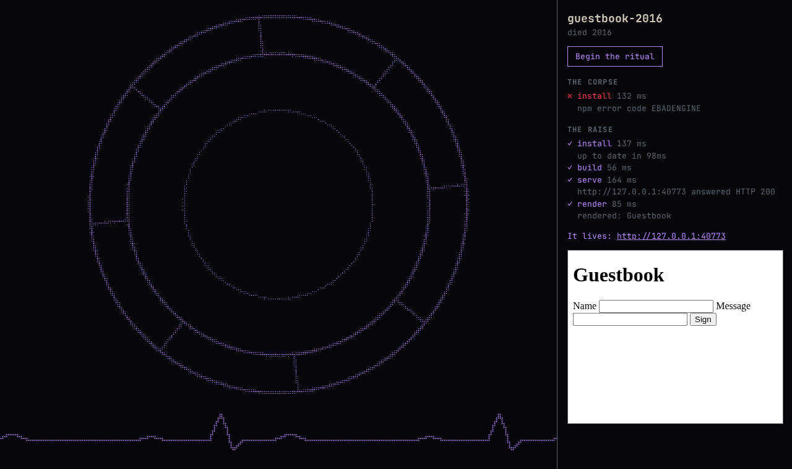
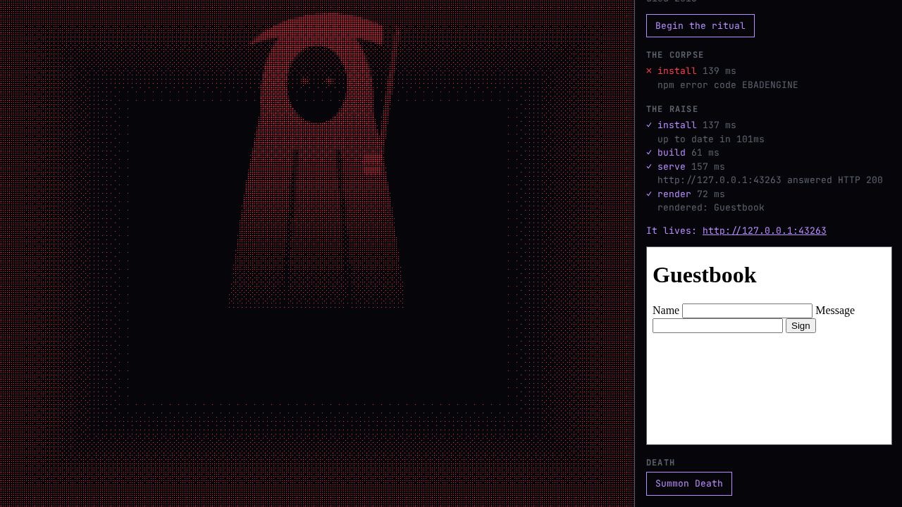
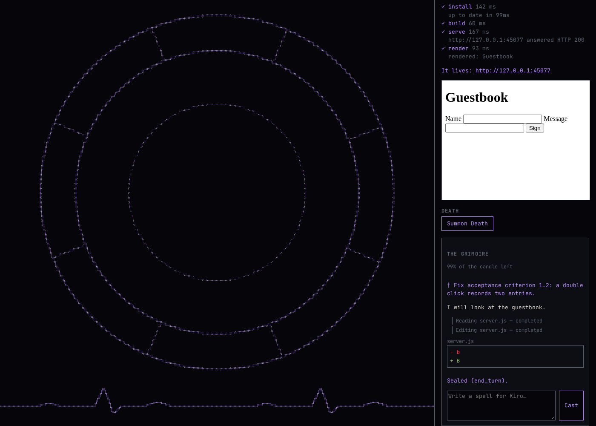

# ⚰️ RE:Animator

> **Raise dead repos. Then survive Death.**

**RE:Animator** is our entry for **[Kiroween 2026](https://kiro.dev)**, in the **Frankenstein** category. This repo stitches two projects into one creature:

- **[Reanimator](reanimator/)**, a necromancer's workbench that takes an abandoned GitHub repo and raises it on a modern toolchain.
- **[Poltergeist](poltergeist/)**, a red-team engine that reads a **Kiro spec** and attacks the running app with adversarial "ghost" users.

You raise a dead project. **Death** comes to break what you revived. You read the wounds he leaves and **heal them with Kiro, your familiar**, until the project survives him.

<p align="center">
  
  
</p>

---

## Kiro is the familiar

Kiro is the agent that does the necromancer's work. It isn't a plugin added at the end: Kiro specs are the input to the whole system, and Kiro's agent closes the loop.

| In the story | What Kiro really does |
|---|---|
| **The chart** (what the body should do) | A **Kiro spec**: `.kiro/specs/<name>/requirements.md`, with acceptance criteria in Kiro's EARS `N.M` format. Poltergeist reads it and turns each criterion into attacks. |
| **The healing** | Kiro's agent fixes each wound in the revived repo. Reanimator writes a brief for each finding to hand to Kiro. |
| **The grimoire** (the spellbook) | Each spell is one headless **`kiro-cli chat`** turn run inside the revived body (`--output-format stream-json`, file tools only). Its stream is drawn live as quill writing, margin notes, ruled-box diffs, a candle for context, and a wax seal when the spell is done. |
| **Daring Death again** | When Kiro seals a heal, Reanimator re-raises the body and re-runs Death on that one wound. The wound closes only if that test now genuinely passes. |
| **Death inside Kiro** | Poltergeist runs as a **Kiro MCP server**, ships a **Kiro agent hook**, a **steering file** and a **Kiro Power**, so Kiro's own agent can summon the ghosts, read the haunting report, fix the code and re-haunt. |

### Every Kiro surface we use

- **Specs.** Both projects are spec-driven. [`reanimator/.kiro/specs/reanimator/`](reanimator/.kiro/specs/reanimator/requirements.md) and [`poltergeist/.kiro/specs/poltergeist/`](poltergeist/.kiro/specs/poltergeist/requirements.md) each hold `requirements.md`, `design.md` and `tasks.md`. Poltergeist's own spec doubles as a test fixture for its spec reader.
- **Steering.** `product.md`, `tech.md` and `structure.md` in each project's `.kiro/steering/` keep the agent on the story, the stack and the rules (for example "nothing is faked for the camera").
- **MCP.** `poltergeist-mcp` exposes five tools over stdio: `list_criteria`, `summon_ghosts`, `get_run_status`, `get_haunting_report` and `rehaunt`. The three read-only tools are auto-approved, and the two that drive a browser ask first. Template: [`poltergeist/integrations/kiro/mcp.json`](poltergeist/integrations/kiro/mcp.json).
- **Agent hooks.** A `PostTaskExecution` hook: when a spec task finishes, Kiro's agent tests the app against the spec, fixes whatever fails and re-checks it, without ever editing the spec to make a test pass. See [`hooks/poltergeist-summon.json`](poltergeist/integrations/kiro/hooks/poltergeist-summon.json).
- **House rules in steering.** `poltergeist init` writes `.kiro/steering/poltergeist.md`. Its `## House rules` section (`disable`, `forbid`, `note`) is read on every run.
- **Kiro Powers.** `poltergeist power --out <dir>` builds a Power in the Agent Plugins format (`plugin.json`, `mcp.json`, `skills/poltergeist/SKILL.md`). Kiro loads it only when a task mentions Poltergeist.
- **Kiro CLI.** The grimoire drives `kiro-cli` headless, so the same familiar that heals in the IDE heals on the stage.
- **Built in Kiro.** Some features are built spec-first in Kiro itself: Kiro writes the spec and implements the tasks, and its output is committed as it is. They are the graveyard (R6), the autopsy (R8), sound and atmosphere (R10), and Poltergeist's demo target, Candy Swap (F10). They're being built in one Kiro session near the demo.

One-command setup for any project you want Kiro to defend:

```sh
npx poltergeist init --dir /path/to/your/project --target http://localhost:3000
```

This writes the MCP entry, the steering file, the agent hook and a loopback-only `poltergeist.config.json`. Details are in [`poltergeist/integrations/kiro/`](poltergeist/integrations/kiro/README.md).

<p align="center">
  
</p>

---

## The loop

```
  graveyard ──▶ RAISE ──▶ it lives ──▶ DEATH attacks ──▶ wounds ──▶ HEAL with Kiro ──▶ dare Death again
               (vitals)              (Poltergeist)     (findings)   (kiro-cli / MCP)        │
                  ▲                                                                         │
                  └────────────── re-raise on real vitals, re-run only that wound ◀─────────┘
```

1. **The graveyard.** Name a dead repo (`https://github.com/<owner>/<repo>`) or raise the bundled practice corpse.
2. **The raise.** The repo is cloned shallow and every command runs in a **bubblewrap sandbox**. A real flatline is proven first, then a fixed set of named rites cures it for Node 22, and four real **vitals** (install, build, serve, render) drive a heart monitor from flatline to a pulse.
3. **Death arrives.** Poltergeist is pointed at the revived app on `127.0.0.1`. It compiles the chart's criteria into attacks and runs them in a real browser. The scene draws the engine's own frames of the app in bone, with Death and his minions in red at the ghosts' real positions.
4. **The reckoning.** Each reproduced finding becomes a **wound**, with its persona, steps and evidence.
5. **The healing.** Cast the wound's brief in the grimoire. Kiro edits the revived repo, and Reanimator re-raises the body and re-runs Death on that wound only.
6. **At peace.** The project stands, revived and hardened.

### Death's minions (the Poltergeist personas)

| Minion | Attack |
|---|---|
| **The Wraith** | Never waits: double-clicks, submits early, goes back mid-action. Finds duplicates and half-finished work. |
| **The Banshee** | Screams junk into every field. Finds inputs that were never guarded. |
| **The Doppelgänger** | Two tabs racing for the same thing. Finds race conditions. |
| **The Lich** | A slow, small, frozen old machine. Finds what breaks only under pressure. |
| **The Revenant** | Comes back with a dead session still in the lock. Finds what trusts an ended session. |
| **The Changeling** | Keyboard only. Finds what can't be reached without a mouse. |

The LLM never writes test code or payloads. It writes a **Haunting Plan** in a small, validated JSON DSL, and the plan runs deterministically with vetted static inputs and generators. A flake filter separates `haunted` from `flaky` and `inconclusive`.

### Nothing is faked for the camera

A pulse means real vitals passed. A wound means a real, reproduced finding. A healed wound means a real fix and a clean re-run. The hosted replay is a recording of a real session, labelled **RECORDED RUN**, with every control locked.

---

## Repository layout

```
reanimator/    THE PRODUCT: the story, the dot-matrix art, the raise, Death's attack scene,
               the heal loop, the grimoire. Vite + React + Canvas 2D, Node + Hono backend.
poltergeist/   THE ENGINE (headless): Kiro spec reader, safety allowlist, route scout,
               personas, ghost compiler, runner, verdicts, haunting report, CLI and MCP server.
  packages/core   the engine
  packages/cli    `poltergeist summon | init | power | export | replay | sandbox`
  packages/mcp    `poltergeist-mcp`, the Kiro MCP server
  integrations/kiro   MCP, hook, steering and Power templates for Kiro
.github/       CI: `npm run health` for both projects, plus a hand-run Pages deploy of the replay
```

## Run it

Requirements: **Node ≥ 22**, `git`, Chromium for Playwright, an **Anthropic API key** (or Amazon Bedrock) for Poltergeist's compiler, **`kiro-cli`** installed and logged in for the grimoire, and **`bwrap`** (bubblewrap) to raise a stranger's repo.

```sh
# the engine
cd poltergeist
npm ci
npx playwright-core install --with-deps chromium
npm run health

# the product
cd ../reanimator
npm ci
npm run server   # backend on http://127.0.0.1:7070
npm run dev      # UI on http://localhost:5173
```

Then press **Begin the ritual**, **Summon Death**, and cast a heal in the grimoire.

- **Try the grimoire without spending Kiro tokens:** `REANIMATOR_KIRO=$PWD/server/fixtures/fake-kiro.mjs npm run server`
- **Record a session:** `REANIMATOR_RECORD=public/recording npm run server`, then open `?replay` or run `npm run build:replay` for the static site.
- **Use Poltergeist from Kiro directly:** see [`poltergeist/integrations/kiro/README.md`](poltergeist/integrations/kiro/README.md).

## Safety

Death only attacks the app you just revived, on loopback. Poltergeist refuses any target that isn't `localhost`/`127.0.0.1`. This is QA and robustness testing of code you own, not an exploit tool. Strangers' repos are cloned without hooks or submodules, size-capped, and every command runs in a bubblewrap sandbox with a minimal environment.

## Status

Built inside the Kiroween 2026 hacking window, from fresh code. Both projects keep `npm run health` (typecheck, lint, tests) green in CI.

- **Built:** the dot-matrix renderer, the raise with real vitals, any GitHub grave in a sandbox, Death's attack via Poltergeist, the attack scene, the heal loop, the Kiro grimoire, and the recorded replay. The Poltergeist engine is built through its CLI, MCP server, `init` hook installer, house rules, Kiro Power, extra personas, Bedrock provider and replay.
- **Still to come:** the features built in Kiro (graveyard, autopsy, atmosphere, Candy Swap), the live heal session with Kiro, and the hero recording.

Progress, decisions and open risks are tracked in each project's `docs/PRD.md`, `docs/DECISIONS.md` and `docs/KNOWN_ISSUES.md`.

## Docs

| Doc | What |
|---|---|
| [reanimator/docs/STORY.md](reanimator/docs/STORY.md) | The story the whole product tells. **Start here** |
| [reanimator/docs/THEME.md](reanimator/docs/THEME.md) | The necromancer's dot-matrix art style |
| [reanimator/docs/PRD.md](reanimator/docs/PRD.md) | Features, build order, status |
| [poltergeist/docs/PRD.md](poltergeist/docs/PRD.md) | The engine's features and status |
| [poltergeist/docs/kiro-notes.md](poltergeist/docs/kiro-notes.md) | What we learned about Kiro's MCP, hooks and Powers |
| [AGENTS.md](AGENTS.md) | The map for anyone (human or agent) working in this repo |

## Licence

[MIT](LICENSE)
